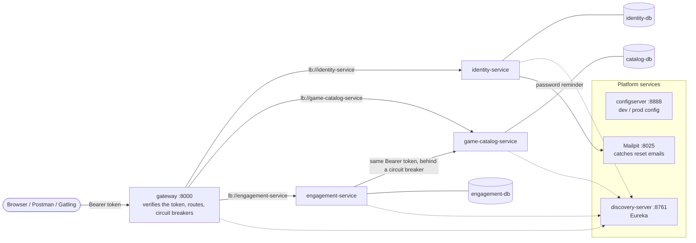

# Cool Engineering Games

A CoolMathGames-style arcade of short, engineering-themed browser games, built as a set of cloud-native microservices.

> **Phase 1** (canonical data model, REST CRUD, Docker, `dev`/`prod` config) is in place and still passes its tests.
> **Phase 2** adds security (registration, login, roles, password reminder), a bearer token that travels across services, service discovery, a gateway in front of everything, and a Gatling stress test. See [Security](#security), [Stress test](#stress-test-scalability-and-resilience) and [Postman](#postman).

## Architecture



The gateway is the only door. In Docker the three business services publish no ports, so nothing can reach them without passing the gateway's token check. Each service still verifies the token itself, so a request that somehow got past the gateway would be refused anyway.

| Module | Port | Role |
|---|---|---|
| `gateway` | 8000 | Single entry point: JWT check, role rules, CORS, circuit breakers, retries, `lb://` routing through Eureka |
| `identity-service` | 8081 (internal in Docker) | Accounts, roles, account status, login (issues tokens), password reminder |
| `game-catalog-service` | 8082 (internal in Docker) | Creator-submitted games, genres, approval status |
| `engagement-service` | 8083 (internal in Docker) | Reactions, library entries, comments |
| `discovery-server` | 8761 | Eureka service registry and dashboard |
| `configserver` | 8888 | Centralized `dev` / `prod` configuration |
| `common-security` | n/a | Library: the JWT setup every servlet service shares |
| `load-tests` | n/a | Gatling simulations |
| `demo-console` | 5500 | Optional demo web page and tiny Node server that call the gateway (see its README); not the project frontend |
| Mailpit | 8025 | Dev/demo mail inbox (web UI and API) |

Each business service is its own Maven module with its own 3-layer stack (entity → repository → service → controller) and its own database. There are no shared tables across services.

## Canonical data model and bounded contexts

Each microservice owns one bounded context and one schema. There are no shared tables and no cross-service foreign keys. A service that needs to reference another context's data (a game's `creatorId`, a comment's `userId`) stores the plain numeric id and nothing else.

| Service | Entity | Key fields | Notes |
|---|---|---|---|
| `identity-service` | `User` | `id`, `username` (unique), `email` (unique, stored lower-case), `passwordHash`, `role` (`PLAYER`/`DEVELOPER`/`ADMIN`), `status` (`ACTIVE`/`SUSPENDED`), `createdAt`, `updatedAt` | Source of truth for accounts. Passwords are BCrypt-hashed and never returned by the API. |
| `identity-service` | `PasswordResetToken` | `id`, `userId`, `tokenHash` (SHA-256, unique), `expiresAt`, `createdAt` | The emailed token itself is never stored. Using it deletes it, so it works once. |
| `game-catalog-service` | `Game` | `id`, `title`, `description`, `genre`, `playableUrl`, `creatorId` (→ `User.id`, by value only), `approvalStatus` (`PENDING`/`APPROVED`/`REJECTED`), `createdAt`, `updatedAt` | Owns the submission and approval workflow. |
| `engagement-service` | `Reaction` | `id`, `userId`, `gameId`, `type` (`LIKE`/`DISLIKE`), `createdAt`, `updatedAt` | One reaction per `(userId, gameId)` (unique constraint). |
| `engagement-service` | `LibraryEntry` | `id`, `userId`, `gameId`, `addedAt` | A player's saved games; one entry per `(userId, gameId)`. |
| `engagement-service` | `Comment` | `id`, `userId`, `gameId`, `body`, `createdAt`, `updatedAt` | Free-text comments on a game. |

`engagement-service` bundles three entities because they share one concern, a player's engagement with a game.

## Security

### Authentication and registration

- `POST /api/auth/register` creates a **PLAYER**. A role in the request body is ignored; elevated roles are granted by an administrator.
- `POST /api/auth/login` takes a username *or* email plus the password and returns a signed JWT (HS256, 1 hour by default) and the user.
- A wrong password and an unknown user produce the identical `401` answer, and both take the same time (the unknown-user path still runs a BCrypt check), so usernames cannot be probed.
- A `SUSPENDED` account gets `403` at login.
- The token carries `sub` (user id), `username` and `roles`. Services read the user from the token, never from the request body.

### Authorization

| Who | May |
|---|---|
| Anyone | register, log in, request a password reset |
| Any logged-in user | read their own account (`/api/users/me`), edit or delete it; read approved games; react, comment and keep a library; edit/remove only their own reactions and comments |
| `DEVELOPER` | everything above, plus submit games and manage their own; see their own games in any state (`?mine=true`) |
| `ADMIN` | everything: list/create/delete users, change roles (verifying a creator = promoting a PLAYER to DEVELOPER), suspend accounts, approve or reject games, delete any comment (moderation) |

Details that matter: a game that is not `APPROVED` looks like it does not exist (`404`) to everyone except its creator and admins; editing an approved game sends it back to `PENDING`; the last administrator cannot be deleted, demoted or suspended; a creator and approval status can never be set from a request body.

Roles live in the token, so a promotion takes effect the next time the user logs in.

### Bearer token across services

1. The client sends `Authorization: Bearer <token>` to the gateway.
2. The gateway verifies signature, issuer and expiry before routing, and applies the coarse role rules.
3. The service verifies the token again and applies its own rules (`@PreAuthorize` and ownership checks).
4. When `engagement-service` needs to know whether a game exists and is visible to the caller, it calls `game-catalog-service` **with the caller's own token**. The catalog therefore applies its visibility rules to the same user: a player reacting to a pending game gets `404`, an administrator reacting to the same game gets `201`. The Postman collection demonstrates exactly this pair.

### Password reminder

`POST /api/auth/forgot-password` always answers `202` with the same message, whether or not the address has an account. If it does, a 32-byte random single-use token is stored as a SHA-256 hash (30 minutes) and a link goes out by email. A new request replaces any earlier link. `POST /api/auth/reset-password` sets the new password and burns every outstanding token for that user. The email is sent in the background so the response time does not give the address away either.

The link points at `${FRONTEND_URL}/pages/auth/reset-password.html?token=...`. In Docker, mail goes to Mailpit; open `http://localhost:8025` to read it. In the `dev` profile the link is also written to the identity-service log.

### Secrets

Nothing secret is committed. `JWT_SECRET` and `BOOTSTRAP_ADMIN_PASSWORD` come from the environment (`docker/.env`, git-ignored; see `docker/.env.example`). Compose and the `prod` profile refuse to start without them. The `dev` profile has an obviously labeled throwaway secret and admin (`admin` / `Admin-dev-12345`) so a laptop run needs no setup. The Postgres passwords in `docker-compose.yml` are placeholders for the demo stack.

## API reference (for the frontend)

Send `Authorization: Bearer <accessToken>` on everything except the four `/api/auth` calls. All calls go to the gateway, `http://localhost:8000`. CORS allows `http://localhost:*` by default (`CORS_ALLOWED_ORIGINS` to change it).

| Method and path | Who | Body | Success |
|---|---|---|---|
| `POST /api/auth/register` | public | `{username, email, password}` | `201` user |
| `POST /api/auth/login` | public | `{username, password}` | `200` `{accessToken, tokenType, expiresIn, user}` |
| `POST /api/auth/forgot-password` | public | `{email}` | `202` always |
| `POST /api/auth/reset-password` | public | `{token, newPassword}` | `200`, `400` if invalid/expired/used |
| `GET /api/users/me` | any | | `200` user |
| `GET /api/users` | ADMIN | | `200` list |
| `POST /api/users` | ADMIN | `{username, email, password, role}` | `201` |
| `GET/PUT/DELETE /api/users/{id}` | self or ADMIN | PUT: `{username, email}` | `200` / `204` |
| `PUT /api/users/{id}/role` | ADMIN | `{role}` | `200` |
| `PUT /api/users/{id}/status` | ADMIN | `{status}` | `200` |
| `GET /api/games?status=&mine=` | any | | `200` list (approved only, unless `mine=true` or ADMIN) |
| `GET /api/games/{id}` | any | | `200`, `404` if hidden |
| `POST /api/games` | DEVELOPER, ADMIN | `{title, description, genre, playableUrl}` | `201`, starts `PENDING` |
| `PUT /api/games/{id}` | creator or ADMIN | same | `200` |
| `PUT /api/games/{id}/approval` | ADMIN | `{status}` | `200` |
| `DELETE /api/games/{id}` | creator or ADMIN | | `204` |
| `POST /api/reactions` | any | `{gameId, type}` | `201`, `409` if already reacted |
| `GET /api/reactions?gameId=&page=&size=` | any | | `200` newest first, 50 per page (max 100) |
| `PUT /api/reactions/{id}` | owner | `{type}` | `200` |
| `DELETE /api/reactions/{id}` | owner or ADMIN | | `204` |
| `POST /api/library` | any | `{gameId}` | `201`, `409` if already saved |
| `GET /api/library` | any | | `200` the caller's own library |
| `DELETE /api/library/{gameId}` | any | | `204` |
| `POST /api/comments` | any | `{gameId, body}` | `201` |
| `GET /api/comments?gameId=&page=&size=` | any | | `200` newest first, 50 per page (max 100) |
| `PUT /api/comments/{id}` | author | `{body}` | `200` |
| `DELETE /api/comments/{id}` | author or ADMIN | | `204` |

Errors: `401` and `403` are JSON `{"status", "error", "message"}`; `400`, `404`, `409` carry a plain-text message. `503` means a dependency is down (the gateway's circuit breaker is open, or engagement cannot reach the catalog) and is safe to retry shortly.

## Requirements

- Java 25 (the poms target 25)
- Maven 3.9+ or 4
- Docker and Docker Compose, for the `prod` stack and the scaling experiments
- Node 18+, only if you want to run the Postman collection from the command line with Newman

## Running with Docker (`prod` profile: Postgres, everything wired through the gateway)

```bash
cp docker/.env.example docker/.env     # then edit: set JWT_SECRET and BOOTSTRAP_ADMIN_PASSWORD
mvn package                            # builds the jars the Dockerfiles copy in (add -DskipTests to skip the 76 tests)
cd docker
docker compose up --build
```

Services wait for their dependencies to report healthy, in this order: config server and Eureka, then the databases, then the services, then the gateway. When everything is up:

| What | URL |
|---|---|
| API (everything goes through here) | http://localhost:8000 |
| Eureka dashboard (registered instances) | http://localhost:8761 |
| Config server (try `/identity-service/prod`) | http://localhost:8888 |
| Mailpit inbox (password reset emails) | http://localhost:8025 |

Data lives in named volumes and survives restarts; `docker compose down -v` wipes it. The compose project is named `cool-engineering-games`, so it will not collide with other compose stacks on your machine.

**Scale a service** (Eureka and the gateway's load balancer pick the new instances up on their own):

```bash
docker compose up -d --scale game-catalog-service=3 --scale engagement-service=3 --scale identity-service=2
```

## Running locally (`dev` profile: H2, no Docker for the services)

Build once so the shared `common-security` library is installed, then start each piece in its own terminal, in this order:

```bash
mvn install -DskipTests
mvn -pl discovery-server spring-boot:run
mvn -pl configserver spring-boot:run
mvn -pl identity-service spring-boot:run
mvn -pl game-catalog-service spring-boot:run
mvn -pl engagement-service spring-boot:run
mvn -pl gateway spring-boot:run
```

Each service has its own in-memory H2 database (console at `http://localhost:808{1,2,3}/h2-console`) and falls back to its local `application-dev.properties` if the config server is not running. The dev administrator is `admin` / `Admin-dev-12345`. For the password-reminder email, run Mailpit: `docker run -d -p 1025:1025 -p 8025:8025 ghcr.io/axllent/mailpit:v1.33.0`. Without it the reset link is still in the identity-service log.

## Profiles

- **`dev`** (default): H2 per service, H2 console on, verbose SQL, throwaway secret and admin.
- **`prod`**: Postgres per service, H2 console off, quiet logging, **no default secrets**. Selected with `SPRING_PROFILES_ACTIVE=prod` (set by `docker-compose.yml`).

The config server serves both profiles for every service, including the gateway.

## Database migrations

Schemas are managed by [Flyway](https://flywaydb.org), one history per service database, in both profiles. Scripts live in each service's `src/main/resources/db/migration/` and run at startup; Hibernate is set to `ddl-auto=validate`.

- To change a schema, add a new file such as `V3__something.sql`. Never edit an applied script. `identity-service` and `engagement-service` already have a `V2` (password reset and account status; paged-listing indexes), applied on top of existing data without touching it.
- The same SQL runs on H2 (PostgreSQL mode) and Postgres, so stick to standard SQL.
- Enums are `varchar` with a `check` constraint. Add enum values with a migration that updates the constraint.
- H2 is pinned to 2.3.232: 2.4.240 has a bug that makes check constraints created by Flyway reject valid rows.

## Tests

```bash
mvn test
```

76 tests: the shared JWT code, every service's repositories (real Flyway migrations on H2), and integration tests that run the real security filter chain with real signed tokens (roles, ownership, hidden games, the password-reminder cycle, the catalog client and its circuit breaker, the gateway's 401/403/CORS behavior).

## Postman

Import `postman/cool-engineering-games.postman_collection.json` and `postman/cool-engineering-games.postman_environment.json` (Import → File, select both), pick the **Cool Engineering Games - Local** environment, and set the `adminPassword` variable to the `BOOTSTRAP_ADMIN_PASSWORD` from `docker/.env` (`Admin-dev-12345` for a local dev run).

The collection has **88 requests and 127 assertions**, all through the gateway, in the order a demo would follow:

1. Authentication and registration
2. Authorization (roles)
3. Game catalog
4. Bearer token across services (engagement calls the catalog)
5. Password reminder (reads the email from Mailpit, so it needs Mailpit running)
6. Account status and admin guard rails
7. Platform: Eureka registry, config server, gateway routes
8. Cleanup (deletes everything the run created, so the collection can be re-run)

Run it top to bottom with the Collection Runner, or from the command line:

```bash
npx newman run postman/cool-engineering-games.postman_collection.json \
  -e postman/cool-engineering-games.postman_environment.json --env-var adminPassword=<your admin password>
```

It passes against the Docker `prod` stack and against the local `dev` stack. To submit it as a shareable **Postman Workspace** link: create a workspace in Postman, import both files, then Workspace → Share → copy the link.

## Stress test: scalability and resilience

`load-tests` holds two Gatling simulations. Both seed real users and approved games through the gateway, drive real bearer-token traffic through the whole system, and delete everything they created.

A player journey is: list games → view a game → read comments → post a comment → react → read the library. The comment and reaction steps make `engagement-service` call `game-catalog-service` with the player's token, so one journey exercises the gateway, service discovery, token propagation between services and all three databases. A second "newcomer" journey registers, logs in and loads a profile, which is the expensive path because it hashes passwords.

`LoadSimulation` also runs a third "security" journey at the same time, in which a rejection is the expected result: a request with no token (401), a tampered token (401), a player listing users (403), a player submitting a game (403) and an administrator listing users (200). It asserts that more than 95% of requests succeed, fewer than 1% fail and the 95th percentile stays under 1,500 ms, so a regression in either speed or access rules fails the run. One run on one instance of each service: 16,406 requests in 1 minute 20 seconds, 0 failed, 95th percentile 26 ms.

```bash
# throughput under steady concurrency (closed model: a faster system completes more journeys)
mvn -pl load-tests gatling:test -Dgatling.simulationClass=edu.arizona.load.LoadSimulation \
    -DadminPassword=<admin password> -Dconcurrent=200 -Dramp=20 -Dhold=60 -DnewcomersPerSecond=3

# constant arrival rate while you stop and kill containers (open model: failures show up as errors, not as fewer requests)
mvn -pl load-tests gatling:test -Dgatling.simulationClass=edu.arizona.load.ResilienceSimulation \
    -DadminPassword=<admin password> -Drate=15 -Dhold=170
```

The HTML report is written to `load-tests/target/gatling/`.

### Scalability

On a laptop every container shares the same cores, so a single instance is never the bottleneck and adding instances mostly adds overhead. To make scaling measurable, `docker/docker-compose.constrained.yml` caps each service at a fraction of a CPU, like a small cloud instance:

```bash
SERVICE_CPUS=0.5 docker compose -f docker-compose.yml -f docker-compose.constrained.yml up -d --scale game-catalog-service=3 --scale engagement-service=3 --scale identity-service=2
```

Measured on one 16-core Windows laptop, 200 concurrent players for 60 seconds, each service capped at 0.5 CPU, single runs (expect run-to-run variation):

| | 1 instance each | 3 catalog + 3 engagement + 2 identity |
|---|---|---|
| Failed requests | **45.5%** | **4.9%** |
| Successful requests per second | 82 | **203** (about 2.5×) |
| Mean response time | 1,050 ms | 725 ms |
| p95 response time | 6.0 s | 3.8 s |

With 1 CPU per service the picture changes, and it is worth knowing why. One instance of each already served about 711 requests/second with 0 failures, and three instances served 769. The median response time still fell from 95 ms to 14 ms, but peak throughput stopped growing because the **single gateway and the shared laptop** became the limit. In a real deployment you would run several gateways behind a load balancer; here the gateway is deliberately a single instance.

### Resilience

Measured with the same setup, probing every second while services were killed:

| Event | What a user saw |
|---|---|
| One of three engagement instances crashed (`docker kill`) | **Before the fixes below:** about a third of writes failed for ~35 s. **After:** zero failed writes. |
| All engagement instances stopped | Instant `503` answers from the gateway's circuit breaker (no hanging requests); catalog and identity unaffected |
| They start again | Automatic recovery. The breaker closed 13 s after the instances finished booting (about 25 s under a 1-CPU cap), with nobody touching anything |
| One catalog instance crashed | No visible failures while it was down (engagement retries once on another instance) |
| Discovery server restarted | Every service re-registered itself within seconds |
| A just-started instance receiving full load immediately | A few seconds of errors while the JVM is still cold; a real deployment would add a warm-up or readiness delay |

### What the load test found and what changed

This is the part worth reading before changing anything near the gateway.

- **Spring Cloud's hidden bulkhead.** At 200 users, 70-80% of requests failed while the services were nearly idle. The cause was a bulkhead that Spring Cloud wraps around every circuit breaker by default, allowing only 25 concurrent calls per route. Excess calls were rejected, counted as failures, and the breaker opened on a healthy service. Disabled (`spring.cloud.circuitbreaker.bulkhead.resilience4j.enabled=false`) in the gateway and in engagement. The gateway now logs breaker state changes, and `GATEWAY_LOG_LEVEL=DEBUG` also logs why each call counted as a failure.
- **A crashed instance stayed in rotation for ~35 s.** Eureka evicted it in about 20 s, but the load balancer cached the instance list for 35 s. The cache is now 5 s, and writes are retried on another instance when the *connection itself* fails (`ConnectException`, `NoRouteToHostException`: Docker reports a killed container as "no route to host", which is why the first attempt at this fix did nothing). A refused connection never reached a service, so retrying a POST cannot apply it twice; a 5xx answer is **not** retried for writes.
- **Unbounded list endpoints.** `GET /api/comments?gameId=` returned every comment ever posted for a game, so response size and CPU grew with every comment. Both comment and reaction listings are now paged (newest first, 50 by default, 100 at most) with a supporting index added by a Flyway migration. In the 3-instance run (1 CPU per service) it raised throughput from 327 to 426 requests/second.
- **Eureka could not register engagement-service.** A `@LoadBalanced RestClient.Builder` bean replaced Spring's default builder, and Eureka's own HTTP client then tried to find the discovery server through Eureka. The load-balanced client is now built directly instead of exposed as a bean. Unit tests cannot see this because they disable Eureka; the Docker run found it.
- **Password hashing dominates the sign-up path.** Each registration and login costs a BCrypt check, so the newcomer journey, not the player journey, caused most of the slow tail. Scale `identity-service` on its own, and see the limitations below.

## Known limitations and next steps

- **Role changes and revocation.** Roles are read from the token, so a demotion or suspension takes effect at the user's next login (up to an hour). There are no refresh tokens or token revocation list.
- **No brute-force protection.** Nothing limits login or sign-up attempts, and password hashing is deliberately expensive, so this is also a denial-of-service lever. Rate limiting at the gateway (for example per IP) is the next step.
- **One shared HMAC secret** signs and verifies tokens. Asymmetric keys (the identity service signs, everyone else only holds the public key) would remove the need to distribute the secret.
- **The gateway is a single instance**, and the config server and Eureka are unsecured because they are only reachable on the internal network.
- **Frontend.** Not part of this phase. The API reference above is the contract; the reset email links to `reset-password.html?token=...`.
- Phase 3 items (message queue, distributed tracing, cloud deployment) are not started.

## Troubleshooting

- **`mvn` fails with `PKIX path building failed` / `unable to find valid certification path`:** your antivirus (for example Avast) is inspecting TLS and its certificate is trusted by Windows but not by your JDK's own truststore, which is why browsers and git still work. Import it into your JDK once:

  ```bash
  keytool -importcert -trustcacerts -noprompt -alias local-tls-proxy -file <exported-root-cert>.cer -keystore "<JAVA_HOME>/lib/security/cacerts" -storepass changeit
  ```

- **`docker compose` fails with `copy docker/.env.example to docker/.env`:** `JWT_SECRET` and `BOOTSTRAP_ADMIN_PASSWORD` are required on purpose.
- **A Docker image pull fails on a CDN request:** the Mailpit image is pulled from GitHub's registry (`ghcr.io`) for this reason; retry or check your network and antivirus.
- **Port already in use:** the stack publishes 8000, 8025, 8761 and 8888. Stop whatever holds them, or change the left-hand side of the `ports:` entries in `docker/docker-compose.yml`.
